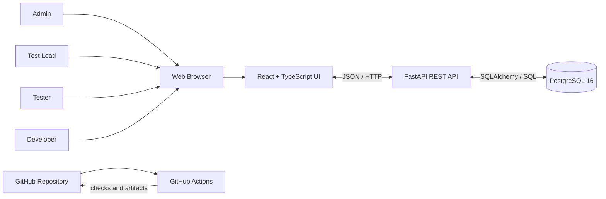
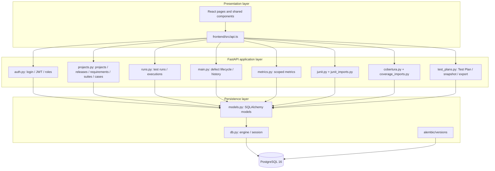
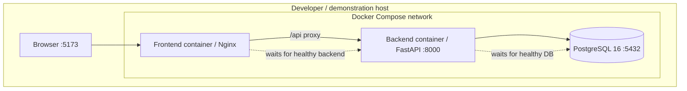
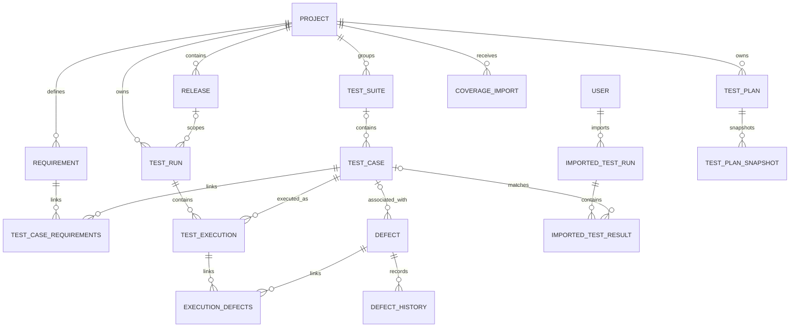
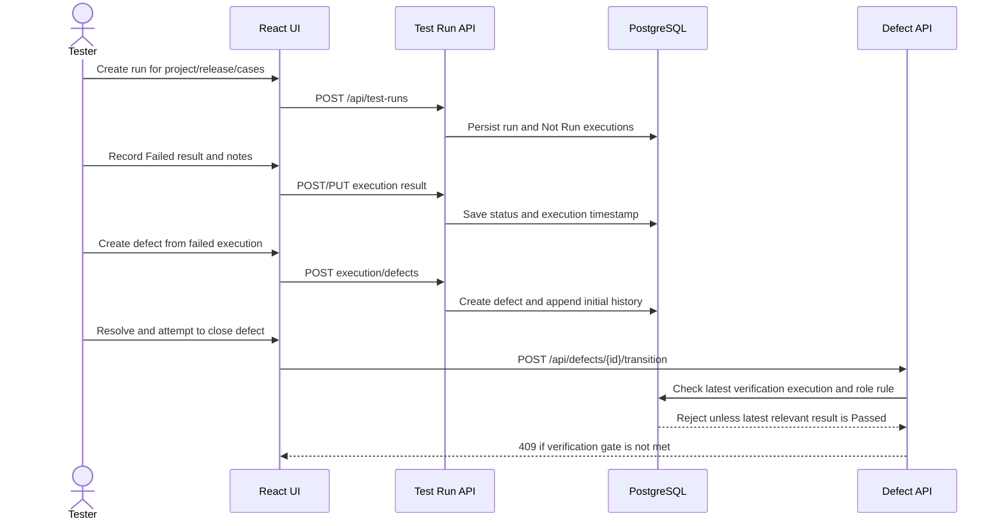

# SDS-06 — Software Design Description (SDD)

**Project:** Agile Test and Defect Tracking System  
**Plan item:** PLN-37 (baseline update)  
**Standard basis:** IEEE 1016 — Software Design Descriptions  
**Version:** 1.0 — Baseline candidate for team approval  
**Prepared:** 22 November 2026  
**Repository:** [Aoreri/SEN0421](https://github.com/Aoreri/SEN0421)

> This SDD describes the architecture and design integrated in `main` on 22 November 2026. Open PR branches are listed as pending integration and are not represented as current runtime behavior. The document is tailored to the academic project and does not claim formal clause-by-clause IEEE 1016 conformance.

## 1. Purpose and scope

This Software Design Description records the system context, component composition, deployment environment, information model, interfaces, control flows, security controls, and design decisions for SDS-06. It provides the design baseline for implementation, verification, change-impact analysis, and final project evaluation.

SDS-06 is a three-tier web application: React/TypeScript frontend, FastAPI backend, and PostgreSQL persistence. SQLAlchemy implements the persistence mapping; Alembic versions schema evolution; Docker Compose orchestrates the local demo; GitHub Actions verifies repository changes.

## 2. Stakeholders and design concerns

| Stakeholder | Design concern |
|---|---|
| Admin | Protected administration, role enforcement, catalogue and release integrity. |
| Test Lead | Project/release planning, test assets, review workflow, release criteria and waivers. |
| Tester | Requirement traceability, test execution, defect reporting, verification evidence. |
| Developer | Defect investigation and implementation-side status transitions. |
| Requirements/documentation owner | Requirement baseline, SRS/SDD, traceability, standards mapping, final work products. |
| Backend contributor | API contracts, business rules, schema, migration integrity, authorization. |
| Frontend contributor | Navigation, forms, state display, API integration, user feedback. |
| QA / DevOps contributor | Reproducible environments, CI, test evidence, release verification. |
| Instructor / evaluator | Demonstrable functionality, standards traceability, V&V evidence, project limitations. |

## 3. Architectural viewpoints

### 3.1 Context viewpoint

Users interact with the browser UI. The UI calls the backend through the shared `frontend/src/api.ts` client. The backend validates requests, applies business rules and role checks, and persists data in PostgreSQL. GitHub Actions runs separately from the application runtime.

### 3.2 Logical / composition viewpoint

The frontend API client centralizes request construction, bearer-token handling, JSON serialization, and HTTP error translation. Backend routers own request validation and authorization; domain rules are enforced server-side rather than being trusted to UI controls.

### 3.3 Component responsibilities

| Component | Main responsibility | Key interface / data |
|---|---|---|
| `frontend/src/App.tsx` | Main navigation, authenticated user state, route composition. | `/`, `/projects`, `/test-cases`, `/test-runs`, `/defects/:id`, `/login`. |
| `frontend/src/api.ts` | Typed REST client and bearer token handling. | API request/response contracts. |
| `frontend/src/pages/ProjectsPage.tsx` | Project, release, and requirement interactions. | Project/release/requirement endpoints. |
| `frontend/src/pages/TestCasesPage.tsx` | Suite/case authoring and requirement traceability. | Test suite, case, and link endpoints. |
| `frontend/src/pages/TestRunsPage.tsx` | Run creation, result recording, run history and failed-execution defect creation. | Test Run / Execution endpoints. |
| `frontend/src/pages/DefectDetailPage.tsx` | Defect detail, allowed transitions, and history. | Defect endpoints. |
| `backend/app/auth.py` | Login, token validation, current-user and role dependencies. | `/api/auth/login`, `/api/auth/me`. |
| `backend/app/projects.py` | Project/release/requirement/suite/case CRUD, traceability, and release-gate behavior. | `/api/projects`, `/api/releases`, `/api/requirements`, `/api/test-suites`, `/api/test-cases`. |
| `backend/app/runs.py` | Test Run creation, execution recording, defect links, and verification gate data. | `/api/test-runs` and execution subroutes. |
| `backend/app/main.py` | Health, defect lifecycle/history, and base metrics registration. | `/api/health`, `/api/defects`, `/api/metrics`. |
| `backend/app/metrics.py` | SQL-backed expanded metrics with project/release/date scoping. | `/api/metrics/expanded`. |
| `backend/app/junit.py`, `junit_imports.py` | Bounded JUnit XML parsing, stable-key mapping, unmatched reporting, snapshot persistence. | JUnit import routes. |
| `backend/app/cobertura.py`, `coverage_imports.py` | Cobertura parsing and coverage evidence persistence. | Coverage import routes. |
| `backend/app/test_plans.py` | Test Plan CRUD, lifecycle, snapshots, Jinja2 HTML, and PDF responses. | `/api/test-plans`. |
| `backend/app/models.py` / `db.py` | ORM entities, relationships, engine, and session dependency. | SQLAlchemy. |
| `backend/alembic/` | Versioned schema and seed evolution. | `alembic upgrade head`. |

## 4. Deployment viewpoint

`docker-compose.yml` defines three services: `db`, `backend`, and `frontend`. PostgreSQL persists data in the named `pgdata` volume. Backend startup runs `alembic upgrade head` before launching Uvicorn. Health checks sequence backend/frontend readiness. The documented local command is `docker compose up --build -d --wait`.

Default local ports are 5432 (PostgreSQL), 8000 (API), and 5173 (frontend). The `DATABASE_URL` variable points to the Compose database from inside the backend container. A `JWT_SECRET` should be configured where a stable signing key is required; the fallback is random per process.

## 5. Information viewpoint

### 5.1 Main entities and relationships

### 5.2 Entity catalogue

| Entity / table | Important attributes / constraints | Design purpose |
|---|---|---|
| `users` | ID, unique username, bcrypt password hash, role. | Login identity. |
| `projects` | ID, unique name, description. | Top-level project scope. |
| `releases` | Project FK, version; project/version unique. | Release planning and gate evaluation. |
| `requirements` | Requirement ID, project FK, title, description. | Requirements catalogue. |
| `test_suites` | Project FK, name, description; scoped name uniqueness. | Grouping of test cases. |
| `test_cases` | Stable string ID, title, suite FK, priority, status, steps, expected result, automation flag. | Test specification and result status. |
| `test_case_requirements` | Composite test-case/requirement key. | Many-to-many traceability. |
| `test_runs` | Project, optional release/suite, name, creator/time. | Execution session. |
| `test_executions` | Run/test-case link, status, actual result, notes, executor/time. | Per-case run result. |
| `execution_defects` | Composite execution/defect link. | Defect association with a failed execution. |
| `defects` | Title, severity, status, optional test case. | Problem records. |
| `defect_transitions` | From/to status and allowed roles. | Server-side transition policy. |
| `defect_history` | Defect FK, from/to status, timestamp. | Append-only audit timeline; PostgreSQL trigger rejects UPDATE/DELETE. |
| `imported_test_runs` / `imported_test_results` | Project, importer, commit/branch, ordered result rows and unmatched reason. | JUnit import snapshots, separate from interactive runs. |
| `coverage_imports` and related coverage data | Project/import metadata, line/branch counters, source linkage. | Cobertura evidence. |
| `test_plans` | Project/release, version, title, lifecycle status, content sections, creator/time. | Versioned Test Plan records. |
| `test_plan_snapshots` | Test Plan FK, version/status, rendered HTML, JSON payload, creator/time. | Point-in-time document evidence. |

The schema is evolved by Alembic revisions `0001` through `0010` on the current `main` baseline. The latest integrated revision is `0010_pln23_coverage`. New changes must start from `0011` and use unique, sequential revisions on a single migration chain.

### 5.3 Traceability integrity decision

The model retains the legacy `test_cases.requirement` field alongside `test_case_requirements`. The API creates/updates the association list and maintains the legacy first-requirement value for compatibility. Do not remove the legacy field without confirming all seed, API, import, and reporting consumers.

JUnit import snapshots (`imported_test_runs` / `imported_test_results`) are deliberately separate from interactive execution (`test_runs` / `test_executions`). Importing a CI report does not silently mutate interactive test-case status or run metrics.

## 6. Interfaces and data flows

### 6.1 Authentication flow

1. User submits credentials through the login page.
2. Frontend calls `POST /api/auth/login`.
3. Backend verifies the bcrypt hash and returns a signed HS256 bearer token with an eight-hour lifetime.
4. Frontend stores the token and includes it on protected API calls.
5. Backend validates signature/expiry and applies route-specific role checks.

At the 22 November baseline, write/workflow operations use server-side authorization; several GET routes remain public. PLN-29 (PR #39) proposes read-endpoint authentication hardening and security scanning but is still an open PR.

### 6.2 Test execution and defect flow

The lifecycle remains `Open → In Progress → Resolved → Closed`, with permitted Reopen transitions from `Resolved` and `Closed`. Every accepted creation/transition appends a history row; invalid transitions or unauthorized roles do not append history.

### 6.3 Test Plan flow

An authorized Admin or Test Lead creates a versioned Test Plan. The backend enforces the `Draft`, `In Review`, and `Approved` workflow and unique `(project_id, version)` values. A snapshot stores rendered HTML and structured JSON payload with version, state, generation identity, and time. The caller can list/read snapshots and request HTML or PDF export for the live plan or a chosen snapshot.

The Test Plan API is integrated on `main`. The dedicated Test Plan management UI is in PR #41 (PLN-31) and is not described as integrated until merged. WeasyPrint runtime rendering still requires container verification; the code has a fallback PDF path.

### 6.4 Import flow

JUnit XML is parsed with input-size/result-count limits, mapped using stable test-case identifiers, and stored transactionally. Unmatched results are retained with a reason. Cobertura XML is parsed into coverage evidence. Imported snapshots remain separate from interactive test runs.

### 6.5 Metrics and release gate flow

`GET /api/metrics/expanded` composes SQL-backed run, requirement, and defect-history measures scoped by optional project, release, and date range. The release gate evaluates configured pass-rate, open-Critical-defect, and requirement-coverage criteria. A waiver records the responsible user, reason, and timestamp without rewriting the measurements.

## 7. Security and data integrity

- Passwords are bcrypt hashes; bearer tokens use HS256 and expire after eight hours.
- Role decisions are enforced in backend route dependencies and defect transition rules.
- Protected write operations return 401 for missing/invalid authentication and 403 for insufficient role.
- Invalid domain transitions return 409; invalid references and schema values are rejected at the API boundary.
- `defect_history` is append-only in PostgreSQL and protected by a database trigger.
- Test data/migrations are run only against disposable databases in automated verification.
- Demo credentials and local Compose database credentials are public development defaults. They must not be reused for production.
- GET-endpoint authentication hardening, Bandit, and npm audit work is in PR #39 and is not yet integrated.

## 8. Build, verification, and configuration management

The GitHub Actions CI pipeline has three major verification surfaces: backend lint/type/tests on a disposable SQLite setup, backend integration tests against PostgreSQL 16, and frontend lint/typecheck/build. PR checks reported success on the open PLN-28, PLN-29, PLN-30, PLN-36, and PLN-39 branches as of 22 November 2026; these per-branch results do not replace verification of the final combined `main` state.

Before merge of new database work, integrate Alembic migrations in one sequence from revision `0010`. Several open work-package PRs introduce new `0011*` revisions; the integration owner must select the order, renumber revisions uniquely, update each `down_revision`, and run `alembic upgrade head` against a disposable PostgreSQL 16 database.

## 9. Standards mapping and design constraints

| Design view / concern | Applicable reference | Project evidence |
|---|---|---|
| Requirements and external interfaces | ISO/IEC/IEEE 29148:2018 | `docs/srs.md`, API contracts, RTM v2. |
| Context, components, data and deployment views | IEEE 1016 | Sections 3–6 of this SDD. |
| Life-cycle, implementation, configuration management | ISO/IEC/IEEE 12207 | Branch/PR discipline, migrations, CI, release tasks. |
| Test processes and evidence | ISO/IEC/IEEE 29119-2:2021 | Test Plan, execution, defect and metrics flows. |
| Test documentation | ISO/IEC/IEEE 29119-3:2021 and course-facing IEEE 829 artefact names | Test Plan snapshots and pending Incident/Log/Summary report PRs. |
| Product quality assessment | ISO/IEC 25010:2023 | `docs/iso-25010-quality-evaluation.md`. |
| Verification and validation | IEEE 1012-2024 | `docs/ieee-1012-verification-results.md`. |

The standard mapping is purpose-based and tailored. It is not a formal certification or claim of complete normative compliance.

## 10. Open design decisions and integration items

1. Confirm original R1–R8 text from the approved course source and replace placeholder requirement descriptions.
2. Implement and measure FR-REQ-02, the release-specific requirement/test outcome report.
3. Measure the traceability p95 target and clean-machine installation target; do not infer either from ordinary CI success.
4. Verify full PDF rendering (including multi-page output) in the supported Docker runtime.
5. Merge and integrate open report/security/sprint/release PRs only after review; sequence their migrations from the integrated `0010` revision.
6. Keep public demo credentials and local secrets out of production-like deployments; configure JWT secret and restricted CORS origins before any external deployment.

## 11. References and version history

1. IEEE 1016 — Software Design Descriptions.
2. ISO/IEC/IEEE 29148:2018 — Requirements engineering.
3. ISO/IEC/IEEE 12207 — Software life-cycle processes.
4. ISO/IEC/IEEE 29119-2:2021 and 29119-3:2021 — Test processes and test documentation.
5. ISO/IEC 25010:2023 — Product quality model.
6. IEEE 1012-2024 — System, software, and hardware verification and validation.
7. Repository sources listed in `docs/srs.md` and the current `main` branch of `Aoreri/SEN0421` (reviewed 22 November 2026).

| Version | Date | Change | Status |
|---|---|---|---|
| 0.1 | 11 November 2026 | Initial architecture/data model description (PLN-14). | Superseded. |
| 0.2 | 18 November 2026 | Added PLN-27 workflow and November module design. | Superseded. |
| 1.0 | 22 November 2026 | Reconciled component, API, data, migration, verification, and open-PR status with the integrated `main` baseline. | Candidate for team/instructor review. |
