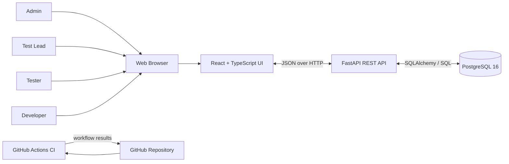
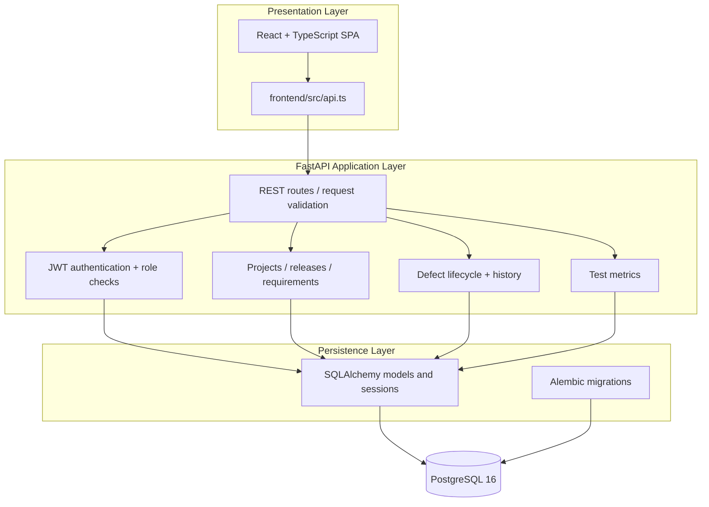
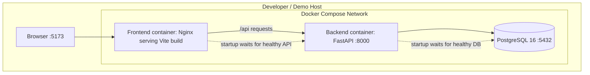
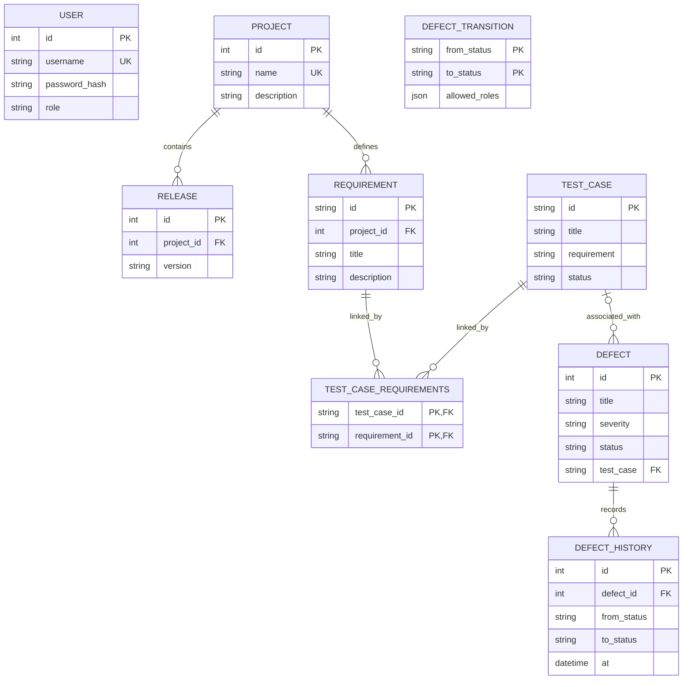
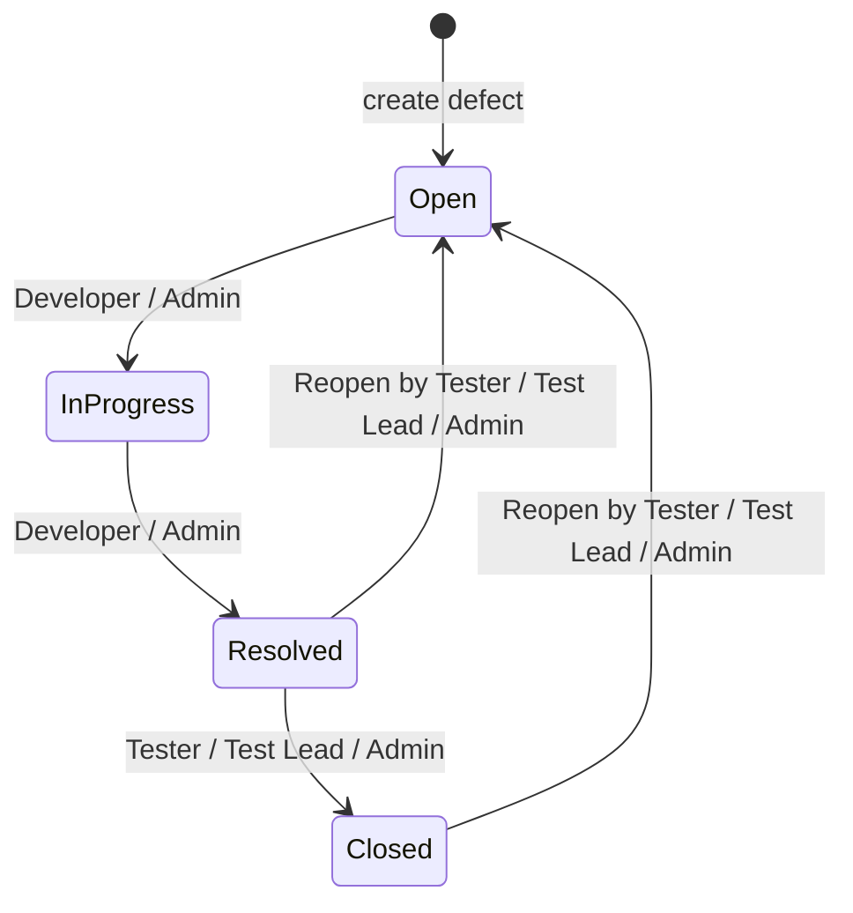

# SDS-06 — Software Design Description (SDD)

**Standard reference:** IEEE 1016 — Software Design Descriptions  
**Work package:** PLN-14  
**Version:** 0.1 — Draft for team review  
**Prepared:** 11 November 2026  
**Project:** Agile Test and Defect Tracking System  
**Repository:** [Aoreri/SEN0421](https://github.com/Aoreri/SEN0421)

> This SDD describes the design visible in the current repository. It is an implementation-oriented design baseline for team review, not a claim of clause-level IEEE 1016 conformance. The CI evidence section records an existing successful workflow run; this documentation change does not create a new CI workflow.

## 1. Purpose and scope

This Software Design Description records the SDS-06 system context, logical composition, deployment arrangement, API boundaries, persistence model, security design, and key design decisions. It supports PLN-14 and provides a reference for implementation, verification, and change impact analysis.

The current architecture is a three-tier web application: React + TypeScript frontend, FastAPI backend, and PostgreSQL database. GitHub Actions is the continuous-integration environment, not a runtime application component.

## 2. Stakeholders and design concerns

| Stakeholder | Main design concern |
|---|---|
| Admin | Administrative access, user roles, catalogue integrity, oversight. |
| Test Lead | Project/release/requirement organization, test traceability, defect verification. |
| Tester | Test-case visibility, requirement links, defect reporting, verification transitions. |
| Developer | Defect investigation and implementation-side transitions. |
| Product owner / requirements contributor | Requirement coverage, traceability, project work products, standards alignment. |
| Backend developer | API contracts, persistence, migrations, authorization, transactional integrity. |
| Frontend developer | UI composition, API integration, validation, error display. |
| QA / DevOps | Repeatable test environment, CI checks, database test evidence, build/deployment setup. |
| Instructor / evaluator | Standards traceability, test artefacts, review evidence, and demonstrated system behavior. |

## 3. Design viewpoints

### 3.1 Context viewpoint

The Context Viewpoint describes the system boundary and external actors. Users interact with the browser UI. The frontend calls the FastAPI REST API. The backend authenticates users, applies role checks, executes business operations, and reads/writes PostgreSQL. GitHub Actions checks source changes independently and publishes workflow results to the repository.

**Concerns addressed:** system boundary, user roles, frontend/backend separation, persistence location, and the distinction between runtime requests and source-code verification.

### 3.2 Logical / composition viewpoint

The Logical Viewpoint separates presentation, API/application behavior, persistence access, and data storage. The backend currently groups authentication in `app/auth.py`, project/release/requirement operations in `app/projects.py`, shared database setup in `app/db.py`, and core records in `app/models.py`. Defect and metric routes are in `app/main.py`.

**Concerns addressed:** separation of responsibilities, dependency direction, testability, and the location of authorization and data integrity controls.

### 3.3 Deployment viewpoint

The Compose file defines three services: `db`, `backend`, and `frontend`. PostgreSQL uses a named `pgdata` volume. The backend uses `DATABASE_URL` to connect to the `db` service, applies Alembic migrations on startup as documented in the repository, and exposes a health endpoint. The frontend image serves the built application with Nginx and routes `/api/` requests to the backend. Local ports are 5432, 8000, and 5173 respectively.

GitHub Actions is outside this runtime deployment diagram. It checks repository changes using hosted runners and a PostgreSQL 16 service for the database-specific test job.

## 4. Information viewpoint and data model

### 4.1 Entity relationship diagram

`USER` and `DEFECT_TRANSITION` are intentionally shown without relationship lines because the current schema does not store a user foreign key on defects/history and the transition table is a rule catalogue rather than a relationship to a specific user row.

### 4.2 Entity/table catalogue

| Table | Key attributes | Purpose / constraints |
|---|---|---|
| `users` | `id` PK, `username` unique, `password_hash`, `role` | Login identity and application role. Password values are stored as bcrypt hashes. |
| `projects` | `id` PK, `name` unique, `description` | Project catalogue. |
| `releases` | `id` PK, `project_id` FK, `version` | Release catalogue; `(project_id, version)` is unique. |
| `requirements` | `id` PK (string), `project_id` FK, `title`, `description` | Requirements belonging to a project. Initial IDs R1–R8 are seeded with placeholder descriptions. |
| `test_cases` | `id` PK (string), `title`, `requirement`, `status` | Test-case catalogue. `requirement` is a legacy string field and is not declared as a foreign key in the current model. |
| `test_case_requirements` | Composite PK (`test_case_id`, `requirement_id`); both are FKs | Many-to-many requirement/test-case traceability. Migration 0004 populates it using the legacy `test_cases.requirement` values. |
| `defects` | `id` PK, `title`, `severity`, `status`, nullable `test_case` FK | Defect records; a defect may refer to a test case. |
| `defect_transitions` | Composite PK (`from_status`, `to_status`), `allowed_roles` JSON | Configurable allowed status transitions and role lists. |
| `defect_history` | `id` PK, `defect_id` FK, `from_status`, `to_status`, `at` | Ordered, append-only record of defect creation and state changes. PostgreSQL trigger rejects UPDATE/DELETE. |

### 4.3 Important traceability design note

The current implementation has both a legacy single-value `test_cases.requirement` string and the many-to-many `test_case_requirements` association. The migration initializes the association table from the legacy string, and the API returns the relationship list. The two representations must be kept consistent during future schema changes. A future migration may remove or formally deprecate the legacy field only after all readers/writers and seed data are updated and verified.

## 5. Component responsibilities and interfaces

| Component / file | Responsibility | Main interface |
|---|---|---|
| `frontend/src/` | Browser UI and user interaction | Calls API functions through `frontend/src/api.ts`. |
| `backend/app/main.py` | Health, test-case list, defect workflow/history, metrics | FastAPI routes under `/api`. |
| `backend/app/auth.py` | Login, JWT validation, role dependencies | `/api/auth/login`, `/api/auth/me`, dependency helpers. |
| `backend/app/projects.py` | Project, release, requirement CRUD and traceability | `/api/projects`, `/api/releases`, `/api/requirements`. |
| `backend/app/models.py` | SQLAlchemy entity definitions and association table | ORM model layer. |
| `backend/app/db.py` | Database engine and session dependency | SQLAlchemy engine/session. |
| `backend/alembic/` | Versioned schema evolution and seed rules | `alembic upgrade head`. |
| `docker-compose.yml` | Local service orchestration and health ordering | `docker compose up --build -d --wait`. |
| `.github/workflows/ci.yml` | Automated verification for repository changes | Push to main, pull requests, and manual dispatch. |

## 6. Main data and control flows

### 6.1 Authentication flow

1. User submits username/password through the frontend.
2. Frontend calls `POST /api/auth/login`.
3. Backend retrieves the user record, verifies the bcrypt password hash, and issues a signed HS256 JWT with an eight-hour lifetime.
4. Frontend uses the bearer token for protected requests.
5. Backend validates token expiry/signature, resolves the user, and applies role checks for protected operations.

The JWT secret is read from `JWT_SECRET`; the current code generates a random process-local fallback when the environment variable is absent. A stable configured secret is required for multi-worker or persistent deployment. The repository's demo configuration is not a production security baseline.

### 6.2 Defect flow

Each accepted creation/transition writes a new `defect_history` row. Unsupported transitions return HTTP 409; role-denied transitions return HTTP 403. A rejected operation should not create a history row. PostgreSQL trigger protection makes the history table append-only.

### 6.3 Requirement traceability flow

1. An authorized user creates or updates a requirement under a project.
2. A Tester, Test Lead, or Admin updates `/api/requirements/{requirement_id}/test-cases` with the target test-case IDs.
3. The backend verifies that each test case exists and replaces the relationship list in `test_case_requirements`.
4. Requirement reads return linked test-case IDs; test-case reads return linked requirement IDs.

## 7. Security and integrity design

- Passwords are stored as bcrypt hashes, not plaintext.
- JWT bearer tokens are signed using HS256 and expire after eight hours.
- Role enforcement is implemented in FastAPI dependencies and transition-rule checks.
- Invalid/expired/forged tokens are rejected with HTTP 401.
- Authorization failures return HTTP 403; unsupported defect transitions return HTTP 409.
- PostgreSQL protects defect history against UPDATE/DELETE through a trigger.
- Demo accounts and local database credentials are public development data. They must be changed and secrets configured before any non-demo deployment.
- The current API CORS configuration is permissive for the template; production origins should be restricted before deployment.

## 8. Continuous integration design and PLN-14 evidence

The current `.github/workflows/ci.yml` workflow runs on pushes to `main`, pull requests, and manual dispatch. It has three jobs:

1. **Backend checks:** Python 3.12; install backend dev requirements; Ruff lint; mypy; pytest with Cobertura coverage output on the default disposable SQLite setup.
2. **Backend PostgreSQL tests:** PostgreSQL 16 service; run backend pytest and generate Cobertura output.
3. **Frontend checks:** Node.js 22; `npm ci`; ESLint; TypeScript type check; Vite production build.

A successful workflow execution is already present on `main`:

- Run ID: `42972187931`
- Date: 11 November 2026
- Conclusion: `success`
- Evidence: https://github.com/Aoreri/SEN0421/actions/runs/42972187931

This provides evidence that the current CI pipeline has completed successfully. It does not prove every future PR will pass, and CI success alone does not verify unimplemented report-generation or result-import functionality.

## 9. Design constraints and open decisions

1. Confirm with the instructor whether course documentation should explicitly baseline ISO/IEC/IEEE 12207:2026 or retain a previously expected edition.
2. Obtain and validate the original full R1–R8 wording. The current database has placeholder requirement descriptions.
3. Decide whether to deprecate the legacy `test_cases.requirement` column after verifying compatibility with all current data and API consumers.
4. Implement and design the application-level JUnit/Cobertura importer, stable test-case key mapping, and unmatched-result report before documenting them as available.
5. Implement document generation and verify PDF/HTML output inside the container before marking report generation complete.
6. Review CORS, JWT secret configuration, demo credentials, and database credentials before any production-like deployment.

## 10. Standards and references

1. IEEE 1016 — Software Design Descriptions (design-description reference).
2. ISO/IEC/IEEE 12207:2026 — software life-cycle process context, subject to instructor confirmation of the course baseline edition.
3. ISO/IEC/IEEE 29119-2:2021 and 29119-3:2021 — testing process and test documentation context.
4. SDS-06 Bi-Weekly Progress Report #1 and Midterm Questions/Evaluation Guide.
5. Repository implementation: `backend/app/`, `backend/alembic/versions/`, `backend/tests/`, `docker-compose.yml`, `.github/workflows/ci.yml`, `README.md`, and `AGENTS.md`.
